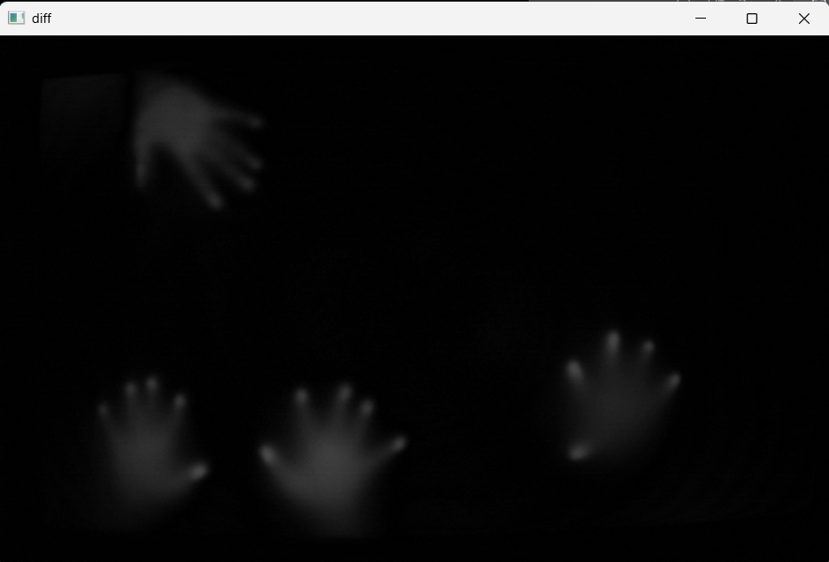
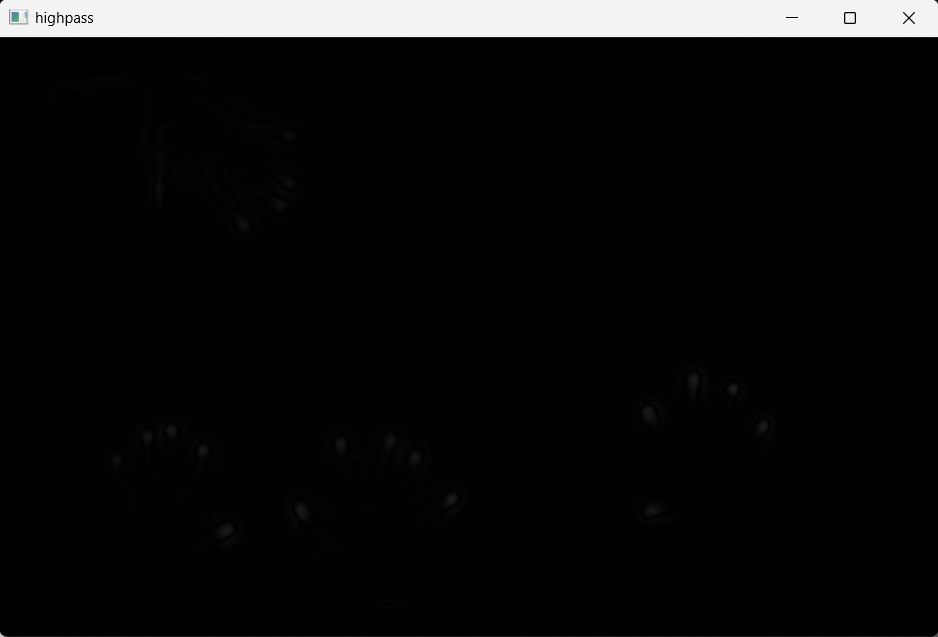
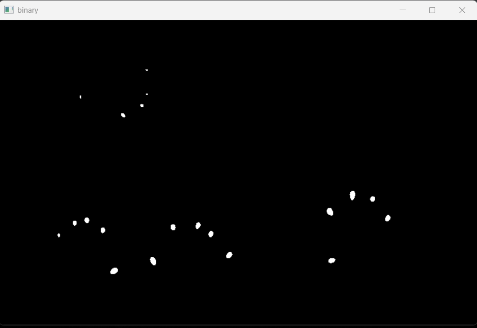
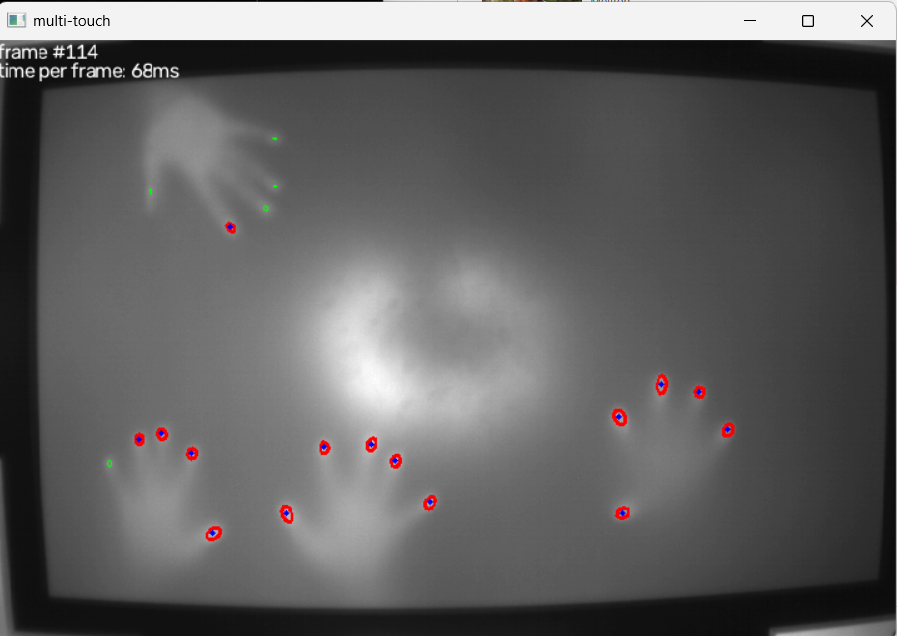

# Multitouch-Praktikum – Fingererkennung, Tracking und TUIO

Das Programm erkennt Fingerspitzen im Video einer Multitouch-Kamera (Infrarot),
gibt jedem Finger eine feste ID und schickt die Berührungen als **TUIO-Cursor**
über das Netzwerk an andere Anwendungen.

| Praktikum | Thema | Code |
|---|---|---|
| 1 | Blob Detection mit OpenCV | `src/blob_detection.py` |
| 2 | Blob Tracking (Nearest Neighbour) | `src/blob_tracking.py` |
| 3 | Touches per TUIO senden | `src/tuio_sender.py` |

```
Video → Blob Detection → Blob Tracking → TUIO-Server ──UDP:3333──→ TUIO-Client
        (Praktikum 1)    (Praktikum 2)   (Praktikum 3)              (TuioDump, TuioDemo, …)
```

## Umgebung

| | |
|---|---|
| Python | 3.12 |
| Paketverwaltung | uv |
| Bibliotheken | `opencv-python` (OpenCV 5.0.0), `python-tuio`, `python-osc` |
| Video | `Video/mt_camera_raw.AVI` |

**Starten:**

```bash
uv sync
uv run python src/blob_detection.py
```

Der Pfad zum Video wird aus dem Ort der Python-Datei berechnet (`Path(__file__)`).
Darum funktioniert das Programm unabhängig vom Arbeitsverzeichnis.

**Projektstruktur:**

```
src/
  blob_detection.py   Pipeline, Fenster, Hauptschleife (run)
  blob_tracking.py    update_tracks: IDs über mehrere Frames
  tuio_sender.py      TUIO-Server, Tracks → Cursor
Screenshots/          Bilder für dieses README
GIMP/                 Ergebnis von Praktikum 1, Teil 1
```

`Video/`, `Bilder/`, `Praktikumsblaetter/` und `dump und demo/` sind Material vom
Dozenten und nicht im Repository (siehe `.gitignore`).

---

# Praktikum 1, Teil 2 – Blob Detection mit OpenCV

## Ziel

Jede Fingerspitze, die die Oberfläche berührt, wird als **Blob** gefunden.
Für jeden Blob bestimmt das Programm **Position** (Mittelpunkt x, y) und **Größe**
(Breite, Höhe, Winkel einer Ellipse) und zeichnet ihn ins Bild.

Wie gefordert wird das **Video** verwendet, nicht die zwei Einzelbilder aus Teil 1.

## Eigenschaften des Videos

Diese Werte habe ich mit OpenCV ausgelesen:

| Eigenschaft | Wert |
|---|---|
| Anzahl Frames | 414 |
| Bildrate | 10 FPS |
| Auflösung | 752 × 480 Pixel |
| `frame.shape` | `(480, 752, 3)`, also Höhe, Breite, Kanäle |
| `frame.dtype` | `uint8` (Werte 0–255) |

Das Video sieht grau aus, ist aber mit **3 Kanälen (BGR)** gespeichert.
Alle drei Kanäle sind gleich. Darum wandle ich jeden Frame zuerst mit
`cv2.cvtColor(frame, cv2.COLOR_BGR2GRAY)` in ein Graustufenbild mit **einem** Kanal um.
`threshold` und `findContours` brauchen ein Bild mit einem Kanal.

## Pipeline

```
Frame (BGR) → Graustufen → Background Subtraction → Hochpass → Glätten
           → Threshold → findContours → Filtern → fitEllipse → Zeichnen
```

| Schritt | Funktion im Code | OpenCV | Was passiert? |
|---|---|---|---|
| 1. Graustufen | `to_gray()` | `cv2.cvtColor` | 3 Kanäle → 1 Kanal |
| 2. Hintergrund | `make_background()` | – | Mittelwert der ersten 20 Frames |
| 3. Background Subtraction | `substract_background()` | `cv2.absdiff` | \|Frame − Hintergrund\| |
| 4. Hochpass | `highpass()` | `cv2.blur` + `cv2.absdiff` | Große Flächen (Handfläche) entfernen, kleine helle Details (Fingerspitzen) bleiben |
| 5. Glätten (optional) | in `run()` | `cv2.blur` | Kleines Rauschen entfernen |
| 6. Binarisierung | `binarize()` | `cv2.threshold` | Nur noch 0 (schwarz) und 255 (weiß) |
| 7. Konturen | `find_contours()` | `cv2.findContours` | Rand jedes weißen Flecks, nur äußere Konturen |
| 8. Filtern | `filter_blobs()` | `cv2.contourArea` | Zu kleine Konturen und Konturen mit weniger als 5 Punkten entfernen |
| 9. Position und Größe | `blob_info()`, `draw_blob()` | `cv2.fitEllipse`, `cv2.ellipse` | Ellipse pro Blob: Mittelpunkt, Achsen, Winkel |

### 1. Hintergrundbild

Für die Background Subtraction braucht man ein Bild **ohne Hand**.
Ich benutze den **Mittelwert der ersten 20 Frames** (Frame 0–19). Der Mittelwert
ist besser als nur der erste Frame, weil sich das Kamerarauschen wegmittelt.

**Warum 20 Frames?** Ich habe jeden Frame mit Frame 0 verglichen:

- Frame 0 bis ca. 21: nur Rauschen
- ab ca. Frame 22: unten links eine schwache Änderung (ca. 8–14 Graustufen), wahrscheinlich eine Hand über der Oberfläche
- ab ca. Frame 40: die Hand ist mit dem Auge gut sichtbar
- ab ca. Frame 46: starke Änderung (mehr als 20 Graustufen)

Mit 30 Frames wäre ein Teil der Hand im Hintergrund „eingebacken“. Mit 20 Frames
ist genug Abstand zur ersten Änderung.

Die Summe wird mit `float32` berechnet, weil `uint8` bei Werten über 255 überläuft
(z. B. 30 × 83 = 2490). Erst am Ende wird das Ergebnis wieder in `uint8` umgewandelt.

### 2. Background Subtraction

`cv2.absdiff(background, gray)` berechnet für jeden Pixel den **Betrag** der Differenz.
Eine normale Subtraktion `gray - background` geht bei `uint8` nicht: Aus 80 − 83 würde
253 statt 3 (Überlauf).

Bei Frame 100: `diff max = 92`, `diff mean = 3.92`. Der größte Teil des Bildes ist fast
schwarz. Die hellsten Pixel sind die Fingerspitzen. In Teil 1 (GIMP) hatte die
**Handfläche** ungefähr den Wert 34. Fingerspitzen sind also klein und hell,
die Handfläche ist groß und mittelhell.



*Differenzbild (Frame 114): Die Hände sind sichtbar, der Hintergrund ist fast schwarz.
Die Fingerspitzen sind heller als die Handflächen.*

### 3. Hochpassfilter

```python
blurred = cv2.blur(img, (ksize, ksize))
hp = cv2.absdiff(img, blurred)
```

Der Blur macht kleine helle Punkte (Fingerspitzen) fast unsichtbar. Große Flächen
(Handfläche) bleiben ungefähr gleich. Zieht man das unscharfe Bild vom Original ab,
verschwindet die Handfläche und die Fingerspitzen bleiben übrig.

Der Kernel muss **größer als eine Fingerspitze** sein.



*Hochpassbild (Frame 114): Die Handflächen sind fast verschwunden. Übrig bleiben
die Fingerspitzen. Das Bild ist sehr dunkel, weil die Werte klein sind.*

### 4. Glätten und Binarisierung

Vor dem Threshold kommt ein zweiter, kleiner Blur (5 × 5). Ein einzelner heller
Störpixel wird dabei mit seinen dunklen Nachbarn gemittelt und fällt unter den
Schwellwert. Eine Fingerspitze ist größer als der Kernel und bleibt hell.

**Vergleich:** Ohne diesen Blur gab es im Binärbild viele kleine Rauschpunkte.
Mit dem Blur war das Ergebnis deutlich sauberer.

```python
_, binary = cv2.threshold(img, thresh, 255, cv2.THRESH_BINARY)
```

`cv2.threshold` gibt zwei Werte zurück. Der erste (der benutzte Schwellwert) wird
nicht gebraucht.



*Binärbild (Frame 114): ein weißer Fleck pro Fingerspitze, sonst schwarz.
Oben links sind einige sehr kleine Flecken. Sie werden im nächsten Schritt herausgefiltert.*

### 5. Konturen und Filter

```python
contours, hierarchy = cv2.findContours(binary, cv2.RETR_CCOMP, cv2.CHAIN_APPROX_SIMPLE)
```

- In Python (OpenCV 4.x und 5.x) heißen die Konstanten `cv2.RETR_CCOMP` und
  `cv2.CHAIN_APPROX_SIMPLE` (in den C++-Folien: `CV_RETR_CCOMP`, `CV_CHAIN_APPROX_SIMPLE`).
- `findContours` gibt **zwei** Werte zurück: `contours` und `hierarchy`.
- Wie in Folie 14 benutze ich nur **äußere** Konturen (`hierarchy[0][i][3] == -1`,
  also keine Eltern-Kontur). Löcher in einem Blob werden so ignoriert.
- Wenn es keine Konturen gibt, ist `hierarchy` gleich `None`. Das passiert in
  50 Frames des Videos (z. B. am Anfang). Der Code prüft das, sonst würde er abstürzen.

Danach bleiben nur Konturen mit:

- Fläche `cv2.contourArea(c) >= MIN_AREA`
- mindestens **5 Punkten**, weil `cv2.fitEllipse` mindestens 5 Punkte braucht
  (eine Ellipse hat 5 Unbekannte: x, y, Breite, Höhe, Winkel).

### 6. Position und Größe

```python
(cx, cy), (w, h), angle = cv2.fitEllipse(contour)
```

Jeder Blob wird als **rote Ellipse** mit einem **blauen Mittelpunkt** gezeichnet.
Konturen, die der Filter entfernt hat, sind nur **grün**.



*Ergebnis (Frame 114): Die Fingerspitzen der drei unteren Hände sind als rote
Ellipsen erkannt. Bei der oberen linken Hand und beim kleinen Finger der linken
unteren Hand sind einige Konturen nur grün, also zu klein für den Filter.*

Beispielausgabe bei Frame 100 (10 Blobs):

```
x=262  y=370  w=7.0  h=15.2  Winkel=135
x=633  y=337  w=8.0  h=9.1   Winkel=45
x=384  y=333  w=6.4  h=16.0  Winkel=25
x=346  y=305  w=5.3  h=10.9  Winkel=180
x=328  y=304  w=3.2  h=12.1  Winkel=2
x=303  y=305  w=5.3  h=13.9  Winkel=172
x=648  y=252  w=6.3  h=12.5  Winkel=166
x=682  y=241  w=5.3  h=13.9  Winkel=15
x=180  y=126  w=5.9  h=7.9   Winkel=121
x=206  y=115  w=5.4  h=6.4   Winkel=110
```

Die meisten Fingerspitzen sind **länglich** (h ≈ 2 × w), weil ein Finger die Oberfläche
meistens schräg berührt. Der Winkel zeigt die Richtung des Fingers.

## Gewählte Parameter

| Parameter | Wert | Begründung |
|---|---|---|
| Hintergrund | Mittelwert Frame 0–19 | Ab ca. Frame 22 ist schon eine schwache Hand sichtbar |
| `BLUR_KERNEL` (Hochpass) | 15 | Größer als eine Fingerspitze, damit die Handfläche verschwindet und die Fingerspitze bleibt |
| `SMOOTH_KERNEL` | 5 | Entfernt kleines Rauschen, Fingerspitzen bleiben |
| `THRESHOLD` | 10 | Am Videoanfang (ohne Hand) ist das Binärbild komplett schwarz, pro Fingerspitze gibt es einen weißen Fleck |
| `MIN_AREA` | 15 (Praktikum 1), aktuell 2 im Code | Bei Frame 100 bleiben mit 15 genau die 10 sichtbaren Fingerspitzen übrig |
| Mindestanzahl Punkte | 5 | Minimum für `cv2.fitEllipse` |

**So habe ich `MIN_AREA` gefunden:** Bei Frame 100 gab es 15 Konturen. Ihre Flächen,
sortiert:

```
77.5, 70.0, 54.5, 53.5, 51.5, 51.0, 41.0, 32.5, 23.5, 19.5 | 13.5, 13.0, 10.5, 7.5, 0.0
```

Die 10 größten sind Fingerspitzen, die kleinen sind Konturen am Rand der Hand.
`MIN_AREA = 15` liegt zwischen den beiden Gruppen.

## Bedienung

Alle Parameter kann man während das Video läuft im Fenster **„parameter“** mit
Schiebereglern (Trackbars) ändern:

| Regler | Bereich | Startwert |
|---|---|---|
| `blur` | 1–101 | 15 |
| `smooth` | 1–31 | 5 |
| `threshold` | 0–255 | 10 |
| `min_area` | 0–500 | 2 |

Bei `blur` und `smooth` ist der kleinste Wert 1 (`max(1, ...)`), denn ein Kernel
der Größe 0 führt bei `cv2.blur` zu einem Fehler.

| Taste | Funktion |
|---|---|
| `p` | Pause (weiter mit einer beliebigen Taste) |
| `ESC` | Programm beenden |

Fenster: `multi-touch` (Ergebnis) und `parameter`. Die Zwischenbilder `diff`,
`highpass` und `binary` sind im Code auskommentiert und können zum Debuggen wieder
eingeschaltet werden.

## Grenzen des Ansatzes

1. **Statischer Hintergrund.** Das Hintergrundbild wird nur einmal am Anfang berechnet.
   Wenn sich das Licht ändert oder die Kamera sich bewegt, ist das Differenzbild nicht
   mehr sauber. Außerdem darf am Anfang des Videos keine Hand im Bild sein.
2. **Kanten am Rand der Hand.** Der Hochpass findet jede plötzliche Helligkeitsänderung,
   nicht nur Fingerspitzen. Am Rand der Hand entstehen deshalb kleine falsche Konturen.
   Sie werden nur über die Fläche herausgefiltert.
3. **Kleine Lücke zwischen Fingern und Störungen.** Bei Frame 100 liegt die kleinste
   Fingerspitze bei 19.5 und die größte Störung bei 13.5. Ein fester `MIN_AREA`
   funktioniert deshalb nicht in jedem Frame gleich gut.
4. **Schwache Berührungen gehen verloren.** In Frame 114 werden einige Finger der oberen
   linken Hand und ein kleiner Finger nicht erkannt (nur grüne Kontur), weil ihre
   Fläche zu klein ist. Ein kleinerer `MIN_AREA` würde sie finden, aber auch mehr
   Störungen durchlassen.
5. **Nur Fläche als Kriterium.** Ein sehr dünner Blob (z. B. `w=3.2 h=12.1` bei Frame 100)
   besteht den Flächenfilter, obwohl er viel schmaler ist als die anderen. Eine Prüfung
   des Verhältnisses `w / h` könnte solche Blobs zusätzlich filtern.
6. **Nahe Finger.** Wenn zwei Finger sehr nah beieinander sind, können ihre Flecken im
   Binärbild zu einem Blob verschmelzen.
7. **Keine IDs.** Jeder Frame wird einzeln ausgewertet. Das wird in Praktikum 2 gelöst.

## Teil 1 (GIMP)

Teil 1 wurde mit GIMP und den Einzelbildern in `Bilder/` gemacht. Das Ergebnis liegt in
`GIMP/1.jpg`. Im Differenzbild hatte die Handfläche ungefähr den Wert 34, der
Hintergrund war nahe 0.

---

# Praktikum 2 – Blob Tracking

## Ziel

Ein Finger soll über mehrere Frames **dieselbe ID** behalten. Daraus ergeben sich die
drei Touch-Ereignisse:

| Ereignis | Bedeutung | Im Code |
|---|---|---|
| Touch Down | neuer Finger | Blob ohne passenden alten Track bekommt `next_id` |
| Touch Move | Finger bewegt sich | alter Track bekommt die neue Position, ID bleibt |
| Touch Up | Finger weg | Track fehlt länger als `MAX_MISSED` Frames und wird gelöscht |

## Datenstruktur

```python
tracks = {id: (x, y, missed)}
```

`missed` zählt, wie viele Frames in Folge der Track keinen Blob hatte. `update_tracks`
gibt jedes Mal ein **neues** Dict und das neue `next_id` zurück:

```python
tracks, next_id = update_tracks(tracks, centers, next_id, MAX_DIST, MAX_MISSED)
```

## Algorithmus (Nearest Neighbour, global sortiert)

1. Alle Paare (Abstand, alte ID, neuer Blob) sammeln, deren euklidischer Abstand
   höchstens `MAX_DIST` ist (`math.hypot`).
2. Paare nach Abstand **sortieren**.
3. Von kurz nach lang zuweisen. Jede alte ID und jeder neue Blob wird höchstens einmal
   benutzt (**Touch Move**).
4. Alte Tracks ohne Partner bleiben an ihrer letzten Position, `missed` wird erhöht.
   Erst ab `missed >= MAX_MISSED` werden sie entfernt (**Touch Up**).
5. Blobs ohne Partner bekommen eine neue ID (**Touch Down**).

Durch die Sortierung wird immer zuerst das global kürzeste Paar zugewiesen. Ohne
Sortierung hinge das Ergebnis von der Reihenfolge der Tracks ab, und IDs könnten
vertauscht werden.

## Parameter

| Parameter | Wert | Begründung |
|---|---|---|
| `MAX_DIST` | 60 Pixel | Maximaler Weg eines Fingers zwischen zwei Frames (10 FPS) |
| `MAX_MISSED` | 3 Frames | Bei 10 FPS = 300 ms. Kurzes Flackern der Erkennung erzeugt kein neues Touch Down |
| `FIRST_ID` | 1 | Erste vergebene ID |

## Anzeige

Die ID wird **gelb** neben jeden Blob geschrieben (`draw_ids`). Tracks mit `missed > 0`
werden nicht gezeichnet, weil es im aktuellen Frame keine Position für sie gibt. Sie
werden aber weiter gematcht und bekommen ihre alte ID zurück, wenn der Finger wieder
auftaucht.

Beim Neustart des Videos werden `tracks` geleert und `next_id` auf `FIRST_ID` gesetzt.


## Grenzen

- **Schnelle Bewegungen.** Bewegt sich ein Finger mehr als `MAX_DIST` pro Frame,
  bekommt er eine neue ID.
- **Keine Vorhersage.** Es wird nur die letzte Position verglichen, nicht die
  Bewegungsrichtung. Kreuzen sich zwei Finger, können die IDs vertauscht werden.
- **Verschmelzende Blobs.** Liegen zwei Finger kurz zu nah beieinander, wird aus zwei
  Blobs einer, und eine ID geht verloren.

---

# Praktikum 3 – TUIO

## Ziel

Die getrackten Finger werden nach dem **TUIO-1.1-Protokoll** (Profil `/tuio/2Dcur`)
per UDP an `127.0.0.1:3333` geschickt. Jede Anwendung, die TUIO versteht, kann die
Touches dann benutzen, ohne etwas über die Bildverarbeitung zu wissen.

## Umsetzung (`src/tuio_sender.py`)

| Funktion | Aufgabe |
|---|---|
| `create_server()` | `TuioServer(TUIO_IP, TUIO_PORT)` erstellen |
| `normalize(x, y, width, height)` | Pixel → Bereich 0..1, auf [0, 1] begrenzt |
| `send_tracks(server, cursors, tracks, width, height)` | Cursor mit den Tracks abgleichen und ein Bundle senden |
| `clear(server, cursors)` | Alle Cursor entfernen und sofort ein leeres Bundle senden |

`cursors = {blob_id: Cursor}` wird in `run()` **vor** der Schleife angelegt und von
`send_tracks` direkt verändert. Es merkt sich, welche Cursor schon existieren.
`cursors` und `server.cursors` werden immer gemeinsam geändert.

Ablauf in `send_tracks` (jeden Frame):

| Schritt | TUIO | Was passiert? |
|---|---|---|
| 1 | fingerUp | Cursor, deren Track gelöscht wurde, aus `cursors` und `server.cursors` entfernen |
| 2 | fingerDown | Neuer Track: `Cursor(blob_id)` anlegen, die **Tracking-ID ist die `session_id`** |
| 2 | fingerMoved | Bestehender Track: nur `position` setzen |
| 3 | – | `server.send_bundle()`: `alive` mit allen aktiven IDs und eine `set`-Nachricht pro Cursor |

**Normalisierung:** TUIO erwartet Koordinaten zwischen 0 und 1. Geteilt wird durch die
Größe des **Kamerabildes** (`height, width = frame.shape[:2]`, also 752 × 480), nicht
durch die Fenstergröße. Werte von `fitEllipse` können knapp außerhalb des Bildes
liegen, deshalb werden sie begrenzt. TUIO und OpenCV haben beide den Ursprung oben
links, die y-Achse muss also nicht gespiegelt werden.

**Tracks mit `missed > 0`** werden an ihrer letzten Position weiter gesendet. So löst
kurzes Flackern beim Client kein fingerUp mit sofortigem fingerDown aus.

**Video-Neustart:** `clear()` sendet ein leeres `alive`. Sonst würde ein neuer Finger
mit einer wiederverwendeten ID beim Client wie ein Sprung des alten Fingers aussehen
(fingerMoved statt fingerUp/fingerDown).

## Testen

1. TUIO-Client starten, z. B. `TuioDump.exe` (Textausgabe der Ereignisse) oder
   `TuioDemo.exe` (grafische Anzeige) aus `dump und demo/`, oder den Java-TUIO-Simulator.
   Alle hören standardmäßig auf Port 3333.
2. Tracker starten: `uv run python src/blob_detection.py`
3. Prüfen:
   - Die Cursor erscheinen an derselben Stelle wie die Blobs im Fenster.
   - Die `session_id` eines Fingers bleibt gleich und stimmt mit der gelben ID überein.
   - Beim Video-Neustart verschwinden alle Cursor.

## Grenzen

- **Keine Geschwindigkeit.** `velocity` und `motion_acceleration` werden nicht
  berechnet und bleiben 0.
- **Nur Cursor.** Größe und Winkel der Ellipse werden nicht gesendet (dafür gäbe es
  das Profil `/tuio/2Dblb`).
- **Feste Adresse.** IP und Port stehen als Konstanten im Code (`TUIO_IP`, `TUIO_PORT`).
- **UDP.** Verlorene Pakete werden nicht neu gesendet. Weil jedes Bundle den
  kompletten Zustand (`alive` + alle `set`) enthält, korrigiert sich der Client aber
  mit dem nächsten Frame.
